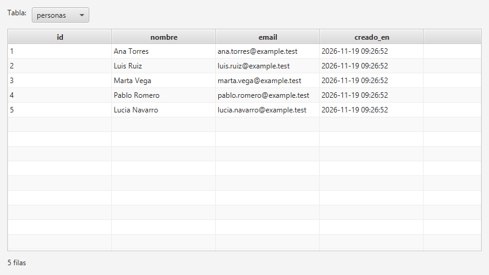

# JavaFX y Hibernate

Aplicación que muestra las tablas de una base de datos MySQL. El selector permite elegir una tabla y el `TableView` muestra todas sus columnas y filas. Hibernate abre la conexión y la aplicación hace consultas de lectura.

## Ejecutar

Se necesita JDK 21 o superior, Maven y acceso a la base de datos de clase. La configuración por defecto apunta a `hello_jdbc` en el puerto 3306 del equipo local.

En el equipo de clase, `hello_jdbc` está en el contenedor Docker `sweet_galileo`, que publica MySQL en el puerto 3306. Si está parado, arráncalo con `docker start sweet_galileo`. En otro equipo, usa en `DB_URL` el puerto publicado que indique `docker ps`.

En IntelliJ IDEA, ejecuta `Main.java`. La aplicación pedirá la contraseña de MySQL en una ventana si no has configurado `DB_PASSWORD`.

Desde PowerShell, también puedes ejecutar `mvn javafx:run`. Si usas otros datos de conexión o quieres ejecutar sin el diálogo, configura las variables antes de arrancar:

```powershell
$env:DB_URL = 'jdbc:mysql://localhost:3306/hello_jdbc'
$env:DB_USER = 'root'
$env:DB_PASSWORD = 'tu_contraseña'
mvn javafx:run
```

## Captura de entrega



